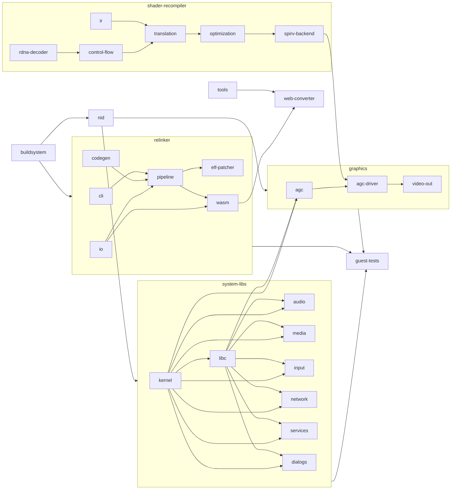

# AnyPS5 架构（模块树）

把 PS5 可执行文件自动移植成 Linux / Windows 原生程序：relinker 把游戏 ELF 转成目标平台格式，系统库（prx）用原生代码重新实现并编成共享库，由操作系统的加载器按 NID 绑定，不做模拟。上游的详细设计文档在 `docs/dev/ARCHITECTURE.md`，本文件只记模块划分。

这份模块树是 2026-10-17 按目录和功能边界从代码、README、`docs/dev/` 和 git 历史归纳出来的；仓库里原来没有 Markdown Memory Protocol 的文件。

## 1. 模块树

每个节点的文档在 `modules/<路径>/` 下：`<名字>.md`、`<名字>.audit.md`、`<名字>.correct.md`。

- **relinker** — 把 PS5 ELF 转成 Linux ELF / Windows PE 的转换器（命令行程序 relinker）。文件夹 `modules/relinker/`
  - **cli** — 命令行参数解析和入口。文件夹 `modules/relinker/cli/`
  - **pipeline** — 核心转换流程：解析、分析、guest 模块、输出。文件夹 `modules/relinker/pipeline/`
  - **elf-patcher** — 把结果写成目标平台格式（Linux ELF / Windows PE）。文件夹 `modules/relinker/elf-patcher/`
  - **io** — 文件读写和输入输出抽象。文件夹 `modules/relinker/io/`
  - **codegen** — `--to-intel`：把只有 AMD 支持的指令降级为 Intel 可执行的代码。文件夹 `modules/relinker/codegen/`
  - **wasm** — relinker 的 WebAssembly 构建，供网页转换器使用。文件夹 `modules/relinker/wasm/`
- **nid** — NID 计算和 nid_patcher：构建后把系统库的导出改名为 NID。文件夹 `modules/nid/`
- **shader-recompiler** — 把 PS5 的 RDNA 着色器重编译成 SPIR-V。文件夹 `modules/shader-recompiler/`
  - **rdna-decoder** — RDNA 指令解码。文件夹 `modules/shader-recompiler/rdna-decoder/`
  - **control-flow** — 建控制流图并结构化。文件夹 `modules/shader-recompiler/control-flow/`
  - **ir** — 中间表示（IR）定义。文件夹 `modules/shader-recompiler/ir/`
  - **translation** — RDNA 到 IR 的翻译。文件夹 `modules/shader-recompiler/translation/`
  - **optimization** — SSA、资源和 binding 分析等优化。文件夹 `modules/shader-recompiler/optimization/`
  - **spirv-backend** — 从 IR 生成 SPIR-V。文件夹 `modules/shader-recompiler/spirv-backend/`
- **graphics** — GPU 相关系统库：AGC 命令缓冲、驱动（PM4 执行 + Vulkan 后端）、视频输出。文件夹 `modules/graphics/`
  - **agc** — libSceAgc：游戏侧构造命令缓冲（DCB/ACB）的 API。文件夹 `modules/graphics/agc/`
  - **agc-driver** — libSceAgcDriver：提交、执行命令缓冲并用 Vulkan 渲染。文件夹 `modules/graphics/agc-driver/`
    - **submit** — DCB/ACB 提交和事件队列。文件夹 `modules/graphics/agc-driver/submit/`
    - **execution** — PM4 包执行：状态、draw、dispatch、着色器注册。文件夹 `modules/graphics/agc-driver/execution/`
    - **vulkan** — Vulkan 后端：管线、资源、guest 内存导入、多重采样、深度面。文件夹 `modules/graphics/agc-driver/vulkan/`
  - **video-out** — libSceVideoOut：显示输出和翻页。文件夹 `modules/graphics/video-out/`
- **system-libs** — 除图形以外的 PS5 系统库（prx）的原生实现，各自编译成共享库。文件夹 `modules/system-libs/`
  - **kernel** — libkernel 及相关运行时库：线程、内存、模块加载、文件、时间。文件夹 `modules/system-libs/kernel/`
    - **threads-sync** — 线程和同步：pthread、取消、信号量、事件标志、equeue、fiber、ULT、job manager。文件夹 `modules/system-libs/kernel/threads-sync/`
    - **memory-modules** — 直接内存、模块加载器、应用元数据、APR/AMM 命令缓冲、sysmodule。文件夹 `modules/system-libs/kernel/memory-modules/`
    - **file-io** — 文件、异步 IO、socket。文件夹 `modules/system-libs/kernel/file-io/`
    - **system-time** — 系统信息、时间、kernel_sys / kernel_web、RTC、随机数、调试和性能工具库。文件夹 `modules/system-libs/kernel/system-time/`
  - **libc** — C / C++ 运行时：libc、libSceLibcInternal、POSIX for WebKit。文件夹 `modules/system-libs/libc/`
  - **audio** — 音频：AJM 解码、AudioOut/In、3D 音频、NGS2、Opus、语音聊天、TTS。文件夹 `modules/system-libs/audio/`
  - **media** — 媒体和数据格式：视频解码、AvPlayer、JPEG/PNG 编解码、字体、zlib、XML/JSON、字符编码。文件夹 `modules/system-libs/media/`
  - **input** — 输入设备：手柄、键鼠、输入法、USB/蓝牙、VR 头显、手势。文件夹 `modules/system-libs/input/`
  - **network** — 网络和 PSN：Net、NetCtl、HTTP/HTTP2、SSL、RUDP、Np*、远程游玩、直播。文件夹 `modules/system-libs/network/`
  - **services** — 系统服务：SystemService、UserService、存档、AppContent、PlayGo、更新、内容管理、分享。文件夹 `modules/system-libs/services/`
  - **dialogs** — 系统对话框：CommonDialog 和各类 *Dialog / Cdlg* 库。文件夹 `modules/system-libs/dialogs/`
- **guest-tests** — 系统库的 guest 集成测试：用真实导入方式调用 prx 库，检查行为。文件夹 `modules/guest-tests/`
- **tools** — 开发和发布用的 Python 工具及其测试。文件夹 `modules/tools/`
  - **progress-report** — 统计系统库和着色器的完成度，生成 progress.json、HTML、SVG 和徽章，以及历史曲线。文件夹 `modules/tools/progress-report/`
  - **repo-checks** — 代码规范和 PR 检查：conventions、skips、测试注册、技术债拆分、PR 冲突、导入审计。文件夹 `modules/tools/repo-checks/`
  - **dev-utilities** — 开发辅助：stub 生成、NID 名字库、trace 摘要、手柄输入、RDNA ISA 表。文件夹 `modules/tools/dev-utilities/`
  - **hw-oracle** — 在真机上跑指令取得参考结果的硬件 oracle。文件夹 `modules/tools/hw-oracle/`
  - **release** — 打包发布产物和网页转换器。文件夹 `modules/tools/release/`
- **web-converter** — 网页转换器：在浏览器里本地跑 relinker（文件不离开设备）。文件夹 `modules/web-converter/`
- **buildsystem** — 构建系统、第三方依赖和 CI。文件夹 `modules/buildsystem/`

## 2. 依赖关系

- **nid ← system-libs、graphics**：每个 prx 库编译完以后，要由 `nid_patcher` 把导出改名成 NID，库才能被转换后的程序绑定。
- **relinker 与 nid**：两者用同一种 NID 约定（relinker 按 NID 读导入、过滤未用 NID），但没有构建依赖；改 NID 计算方式时两边要一起改。
- **graphics/agc-driver ← shader-recompiler**：驱动在注册和使用着色器时调用 `ShaderRecompiler::Recompile` 得到 SPIR-V。
- **graphics、system-libs/* ← system-libs/kernel、system-libs/libc**：所有库都用 kernel 的线程、内存、文件和 libc 运行时。
- **graphics/agc-driver ← graphics/agc**：agc 构造的命令缓冲由 agc-driver 提交和执行。
- **graphics/video-out ← graphics/agc-driver**：显示的画面来自驱动渲染的结果。
- **system-libs/media ← core/Decoder**（在 media 模块内）：JpegDec / PngDec 用 `core/Decoder` 的解码器。
- **guest-tests ← system-libs、graphics、relinker**：guest 测试按真实导入方式调用这些库。
- **web-converter ← relinker/wasm、tools/release**：网页加载 relinker 的 wasm 构建，由 `tools/build_web.py` 打包。
- **tools/progress-report ← system-libs、graphics、shader-recompiler**：只读源码统计完成度，不链接它们。
- **buildsystem ← 全部**：顶层 CMake 构建所有模块，CI 跑构建、测试和规范检查。

## 3. 连接方式

- **relinker → 原生程序**：输入 `input.elf` 和 `sce_module/*`，输出 `app.elf` / `app.exe` 和 `app0/sce_module/*`；导入仍以 NID 命名，SysV dynamic 段（Linux）或 PE 导入表（Windows）指向 `libs/*.prx`。
- **系统库 → 原生程序**：每个库是一个共享库，导出名是 NID（由 nid 模块改名），由操作系统加载器在启动时绑定，调用方向是游戏 → 库。导出函数用 `APS5_VABI` 定义；未实现的导出抛 `std::runtime_error`。
- **图形流水线**：游戏用 agc 写命令缓冲 → agc-driver/submit 接收 DCB / ACB → agc-driver/execution 执行 PM4（状态、draw、dispatch）→ 着色器先查内存和磁盘缓存（`ShaderDiskCache`），没有就交给 shader-recompiler（RDNA → IR → SPIR-V）→ agc-driver/vulkan 建管线、导入 guest 内存、渲染 → video-out 翻页显示。
- **shader-recompiler 内部**：rdna-decoder → control-flow → translation（产出 ir）→ optimization → spirv-backend，入口 `core/shader/recompiler/Recompiler.cpp`。
- **web-converter**：浏览器的 Web Worker（`demo/web/worker.mjs`）加载 `relinker_wasm.mjs`，在本地处理文件，不上传。
- **tools/progress-report**：读 `core/libs/prx/<库>/` 里的 `APS5_VABI` 定义，输出 `progress.json`、HTML、SVG 和徽章，由 `.github/workflows/progress.yml` 发布。

## 4. codegraph

箭头 A --> B 表示 B 依赖 A（先有 A）。实施顺序大致是从左到右：基础设施和运行时先，图形和上层服务后，测试和工具贯穿全程。

